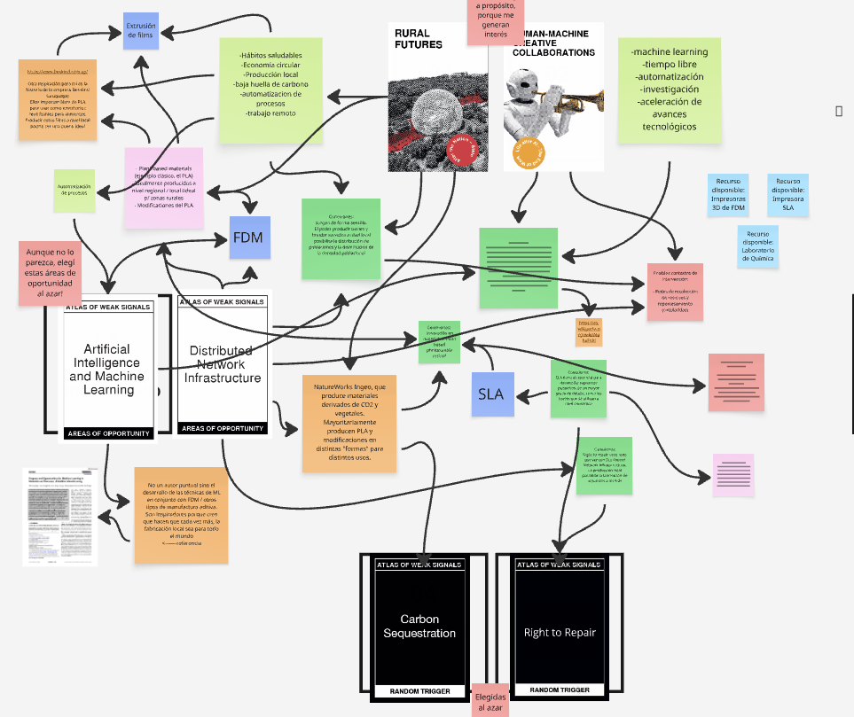
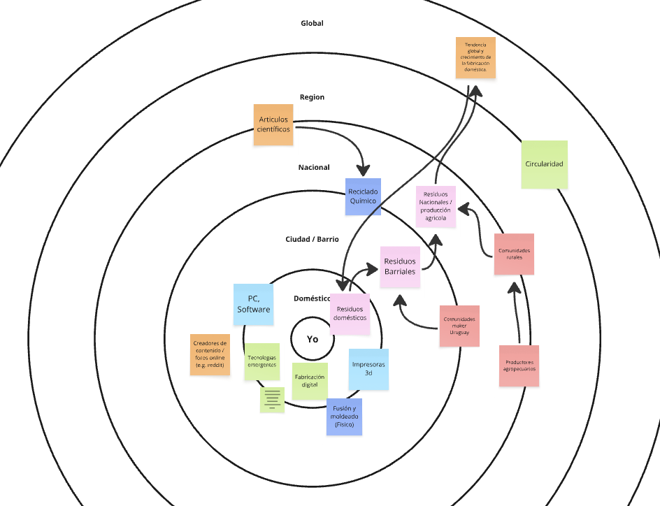

# MD01: Espacios de Diseño y Futuros Posibles

*Montevideo, 21 de setiembre de 2026*

## Reflexión sobre la Actividad 2 (Tarea final MD01)

Como se puede ver en las imágenes de los Canvas realizados, los espacios diseñados contienen una fuerte carga de un interés particular o preocupación previa que tengo: **la generación de residuos en la fabricación doméstica**. 

En ese sentido, si bien parte de este ejercicio fue realizada tomando cartas al azar, el desarrollo de esta actividad y la elaboración del espacio de diseño está fuertemente guiada por los intereses e inquietudes personales.

Me parece una herramienta excelente para elaborar ideas y para interconectar conceptos. Con el uso se puede mejorar notablemente en la habilidad de ver conexiones u oportunidades que a simple vista no resultan evidentes. Esto fue lo que experimenté a lo largo de la tarea: a medida que avanzaba, las conexiones resultaban más sencillas de encontrar. La parte más desafiante, sin embargo, fue conectar todo lo desarrollado con **posibles futuros**.

---

## Diseño del Espacio Multiescalar

El diseño del espacio multiescalar también supuso un reto. Sobre todo, creo que los futuros imaginados cobran mayor sentido en la escala **doméstica y barrial**:

* **Escala local y doméstica:** La fabricación local y los futuros rurales, junto con el *derecho a reparar*, se asocian directamente al individuo y a la comunidad cercana.
* **Escala regional y global:** El interés por estos tópicos apunta fundamentalmente a impulsar y sostener el desarrollo de lo local y lo doméstico.

Si bien resultó una herramienta sumamente dinámica y con gran potencial reflexivo, requiere práctica continua para habituarse a su metodología. Ante la definición de un proyecto concreto para el curso, estos espacios de diseño constituyen una herramienta de gran valor para iterar, reflexionar y registrar las conexiones conceptuales emergentes.

---

## Registros de la Actividad (Canvas)

A continuación se presentan las capturas de los tableros desarrollados:

### Espacio de Diseño / Cartas de Futuro

### Matriz Multiescalar y Conexiones

