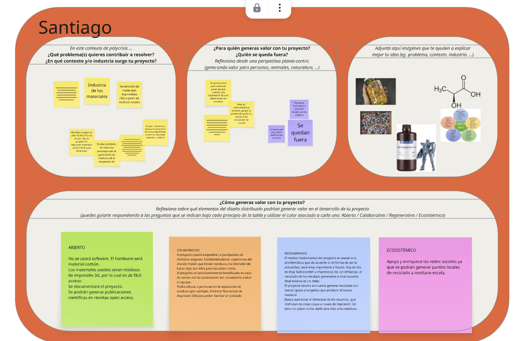

# MI01: Innovación y Sostenibilidad - Diseño Distribuido (DD)

## Análisis de Impacto y Principios de Diseño Distribuido

*Tablero de reflexión y alineación con los principios de Diseño Distribuido.*

---

## Reflexión Conceptual

Si bien aún no tengo completamente cerrado cuál será el proyecto final integrador, tengo claro mi interés central: **la generación de un material novedoso e imprimible en 3D (resina o filamento plástico)**. 

### Objetivos y Enfoque de Sostenibilidad
* **Origen:** Materias primas de origen vegetal o revalorización de desechos generados dentro de la propia comunidad *maker*.
* **Economía Circular y Local:** Desarrollar un material eco-amigable con un ciclo de vida difuso o cerrado, donde los restos y prototipos puedan ser reprocesados y reincorporados en la misma actividad productiva o en industrias afines.
* **Impacto Comunitario:** Fomentar la producción a escala local/comunitaria, minimizando sustancialmente las emisiones y costos asociados al transporte y almacenamiento masivo, y reduciendo la disposición final de residuos plásticos.

---

## Conclusiones sobre la Actividad
La realización de este análisis resultó de gran utilidad para contrastar la idea inicial contra el marco teórico de **Distributed Design (DD)**:

1. **Alineación previa intuitiva:** Varios de los conceptos pensados ya cumplían de forma natural con premisas de diseño distribuido y circularidad, aun antes de haber profundizado formalmente en el término.
2. **Oportunidades de mejora:** Identificación de aspectos del ciclo de vida y colaboración abierta que requerirán mayor atención y esfuerzo metodológico a lo largo de la especialización.
3. **Límites y especificidades:** Reconocimiento de aquellos principios de DD que no necesariamente aplican o resultan viables en la formulación particular de este desarrollo de materiales.
