# MT01: Gestión de proyectos y desarrollo web

Las tareas semanales del MT01 consistían en: 

* Presentarse en el foro del curso.
* Crear una cuenta de Discord y unirnos al servidor de EFDI.
* Crear una cuenta de GitHub para tener el repositorio de nuestra página web.
* Construir una página web con MkDocs y subirla a GitHub pages.
* Documentar el proceso.

---

## Introducción: El objetivo de esta semana

El objetivo esta semana era crearnos un usuario de GitHub, Discord y armar un sitio web con un template para poder comunicar y documentar los avances en toda la EFDI.

## Antecedentes

En mi caso, tenía GitHub creado. No porque sepa usarlo: mi primer repo fue el creado para este curso. Debo reconocer que me gustó tanto GitHub que hice para mi trabajo un segundo repo, con un software que estoy desarrollando (de forma muy principiante) para la gestión de parciales y exámenes.

En el caso de Discord, conozco la plataforma. La he usado para jugar online (mayoritariamente el chat de voz), pero también los foros y subforos en algún curso de Machine Learning que hice hace ya un tiempo.

---

## Bitácora de trabajo

### 4 de setiembre de 2026

Luego de instalar GitHub, crear mi cuenta y hacer el repositorio clonado mediante los tutoriales compartidos en el EVA, llegué al punto de editar el template de la página web del curso.

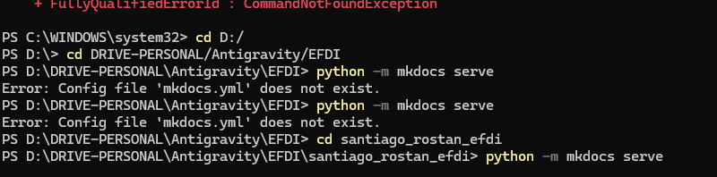

En este caso el error que tuve fue un tema de directorio. El archivo `mkdocs.yml` se encontraba en la carpeta de mi repo, pero yo estaba una carpeta más atrás.

Luego de lograr clonar todo el repositorio y acceder al archivo `mkdocs.yml`, trabajando con Antigravity quise editar el documento (pero no que lo haga la IA automáticamente, para comprender el proceso). Ignoraba que Antigravity IDE es el editor de código y no podía editar manualmente el archivo markdown en Antigravity. Luego de instalar Antigravity IDE pude editar manualmente el archivo markdown.

Tuve que aprender la lógica del repositorio. El archivo de configuración parece englobar la estructura del sitio. Luego diversos subarchivos contienen la info de cada página.

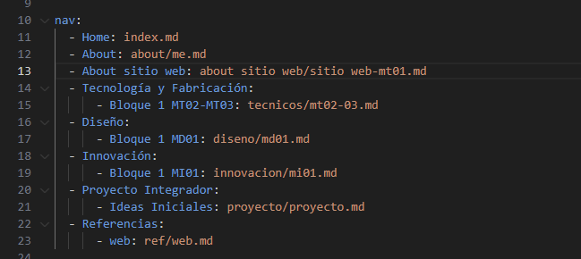

En este punto tuve que revisar toda la estructura de la web porque no tenía claro si todas las pestañas del template ya estaban adaptadas al curso actual.

Tuve complicaciones para colocar la imagen en la página "About Me", como se puede ver en la siguiente captura:

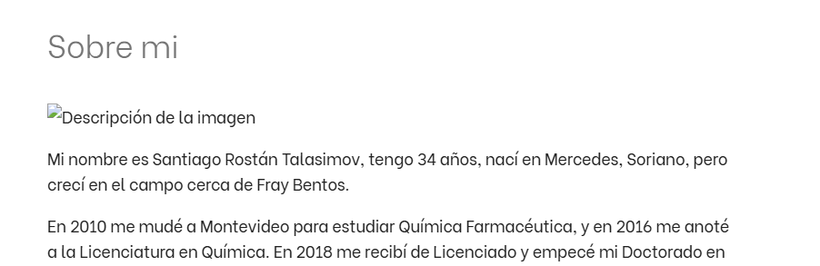

Le pedí ayuda a Gemini en Antigravity, pero probé las dos soluciones que me ofrecía y no pude arreglar el problema.

Luego encontré que se trataba de un error de tipeo que ya había corregido pero que, al no haber guardado los cambios en el archivo del repo local (seguía abierto el archivo en el IDE pero con el punto blanco en la pestaña del editor), los cambios no aparecían online.

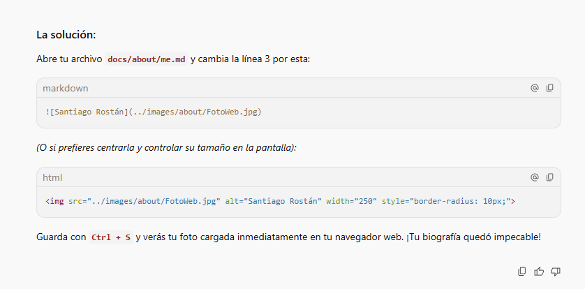

Tratando de levantar mkdocs para visualizar mi web tuve este error en consola:

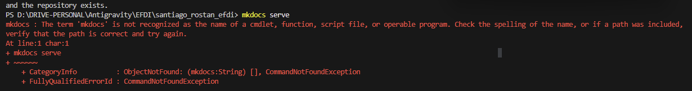

En este caso se trataba de un problema con la instalación de mkdocs. Me di cuenta porque la terminal me decía que no reconocía el término como *"operable program"*. Volví al tutorial, reinstalé mkdocs y logré ver la imagen en mi web local.

---

### 10 de setiembre de 2026

Como me fui de viaje laboral en el medio de todo, tuve que instalar todo en mi portátil, que en lugar de ser Windows es Mac.
Uno de los problemas que estuve un rato para solucionar es que el comando `python` o `pip` no funcionan en Mac. Para llamar a python tuve que usar `python3` o `pip3`.

Un problema que tuve y no entiendo mucho por qué, es que el sitio mío muestra el contenido del `README.md` en lugar del contenido de la carpeta `/site`:

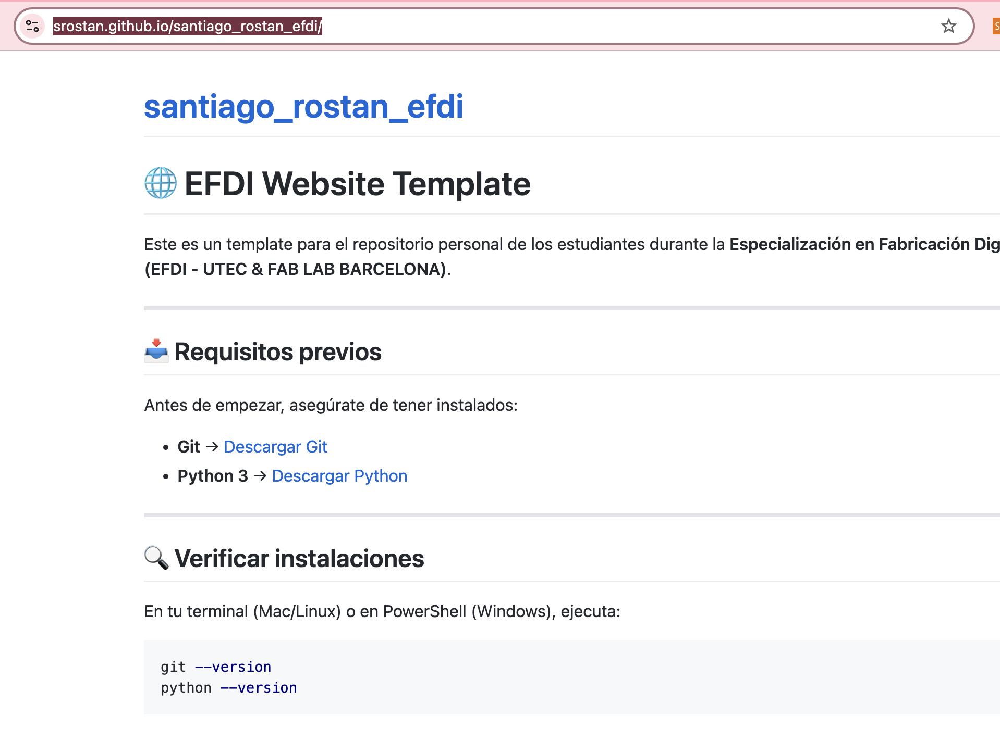

El problema en este caso era que el GitHub Pages (GitHub site) estaba configurado en la rama `main` y no en la rama `gh-pages`. Fue cambiar esa configuración en GitHub y listo.

---

### 12 de setiembre de 2026

El problema de la imagen de la página de About volvió cuando subí el sitio a GitHub Pages.
En este caso el problema eran dos cosas: primero, olvidé realizar un commit. Segundo, no tuve suficiente paciencia: parece que luego del commit, GitHub toma unos 2 o 3 minutos en cargar la nueva página.

Cuando la imagen cargó, no estaba centrada. No me gustaba mucho, así que cambié la configuración de la línea en el archivo `me.md`:

```html

```

Para personalizar un poco el sitio y que sea algo diferente al template original, edité un poco el archivo `mkdocs.yml`:

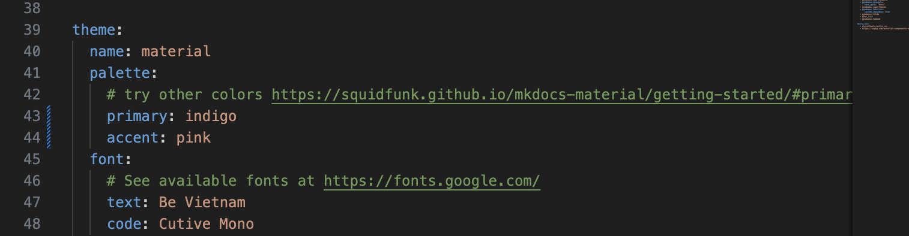

Hice algunos pequeños cambios manuales en el `index.md` del sitio; la verdad que no entiendo mucho la función del archivo de imagen ahí presente, ya que cuando commiteo los cambios a GitHub no veo esa imagen en ningún lado. Los cambios de texto sí se ven. Ampliaremos...

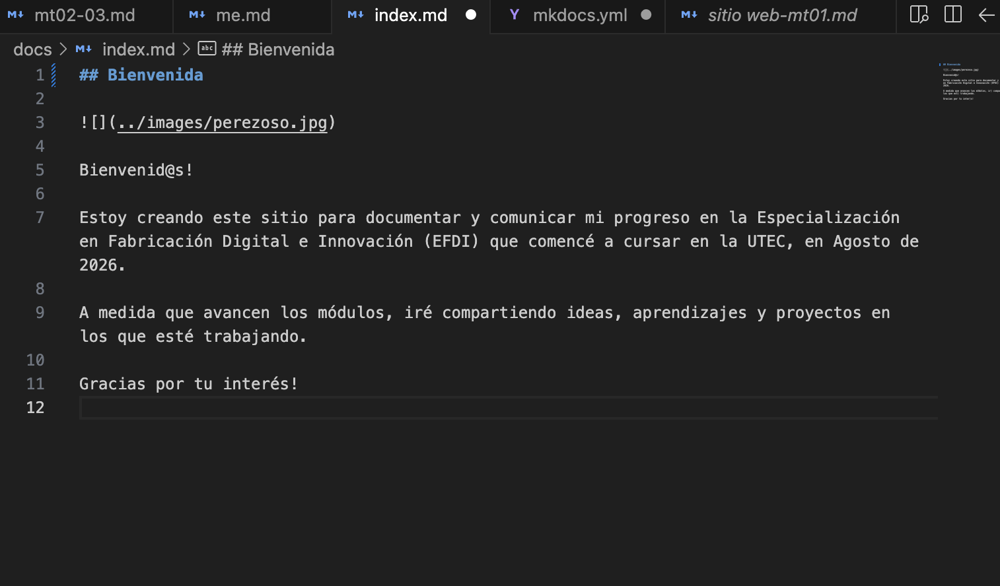

---

### 13 de setiembre de 2026

Hoy actualicé algunas cosas. Ya estoy familiarizado con el flujo de trabajo. Para mí lo más cómodo es editar en Antigravity IDE (que es prácticamente idéntico visualmente a VS Code, que yo había utilizado antes en un curso de Python que hice). Luego de editar en el IDE, uso tres comandos permanentemente:

* `git add .`: actualiza el índice de archivos en el área de preparación (*staging*).
* `git commit -m "comentario"`: su función es crear una especie de *checkpoint* de los cambios realizados.
* `git push`: envía los cambios de mi repo local al repo remoto en GitHub.

Luego de esto espero unos minutos porque los cambios no son inmediatos (vi que puedo seguir el progreso del despliegue en GitHub Actions).

Quise cambiar los íconos de redes sociales para que funcionen, y sacar los que no uso:

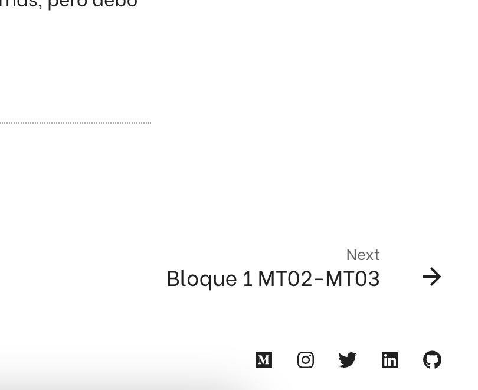

Tuve un error con el ícono de X. No pude comprender qué error tenía mi enlace al ícono correcto. Consulté a Antigravity, y el problema es que la versión de la plantilla de mkdocs es vieja y el logo de X está para versiones más nuevas. De todas formas, el cambio de plantilla implicaría mucho trabajo y potencial demora y no quiero cambiarlo ahora justo antes de la entrega de la primera tarea, así que quedó con el viejo ícono del pajarito de Twitter.

---

### 14 de setiembre de 2026

Un cambio que quiero hacer es poner todo el texto de la web en justificado. Ese cambio lo logré agregando una línea de código dentro del archivo `extra.css` en la carpeta `stylesheets`:

```css
p {
    text-align: justify;
}
```

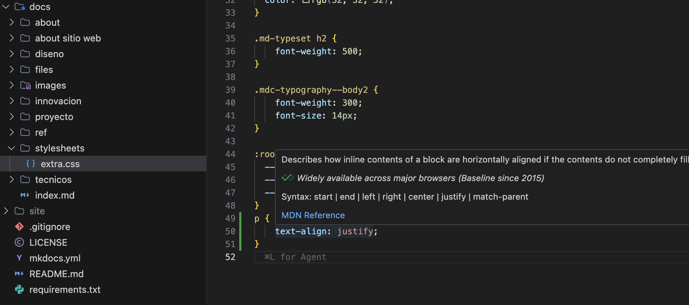

Hoy quiero subir esta documentación a la web. Voy a probar de insertarla como un PDF.

Cuando hice la prueba, no pude ver la nueva pestaña. El problema es que, si bien creé el archivo, no coloqué en el `mkdocs.yml` el enlace a la nueva pestaña.

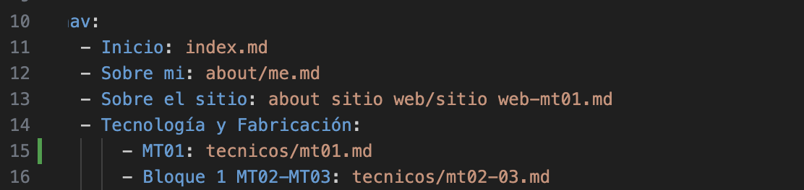

Luego del commit, cuando hice la prueba del sitio, la pestaña fue creada pero no lograba ver el archivo:

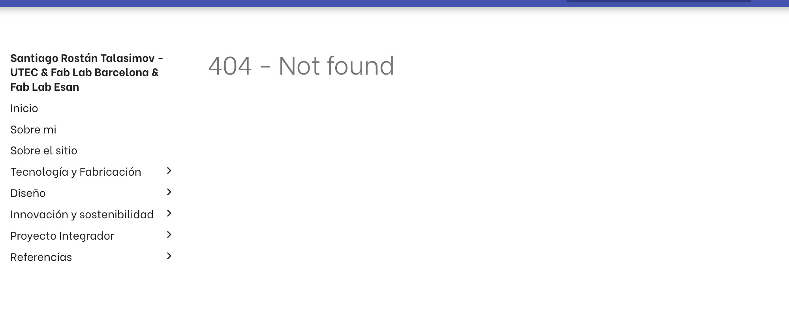

Era un error de mayúsculas/minúsculas en el nombre del archivo PDF.

---

## Documentación descargable

Si preferís consultar la versión original del documento generado durante la entrega:

* [Descargar Documentación MT-01 (PDF)](../files/doc-mt01.pdf)
