# MT02: Diseño Paramétrico y Prototipado - Lab Bumper

## 1. El Problema y la Solución

* **El problema:** Necesidad de proteger frascos y tubos de reacción de vidrio en el laboratorio contra golpes y caídas accidentales.
* **El desafío:** Al estar modelando fuera del laboratorio no contaba con las dimensiones definitivas del frasco.
* **La solución:** Desarrollar un protector anular (*bumper*) mediante **diseño 100% paramétrico** en Autodesk Fusion, permitiendo actualizar todas las dimensiones y tolerancias de forma instantánea al ingresar las medidas finales.

---

## 2. Modelado Paramétrico en Autodesk Fusion

### Sketch y definición de parámetros
Se comenzó modelando el tubo de vidrio de referencia a partir del cual construir el collar protector:

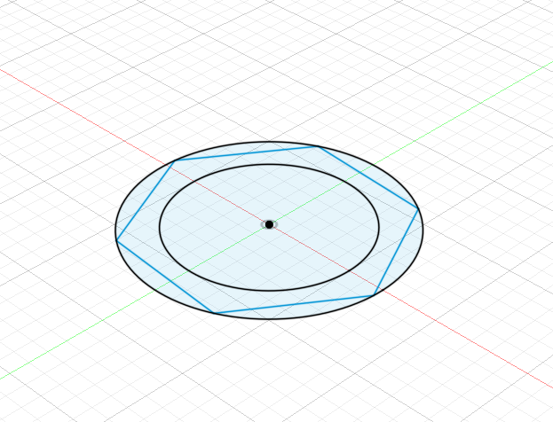
*Sketch de la base del tubo de referencia.*

A través de la tabla de parámetros de Fusion se definieron variables dimensionales con nombres descriptivos:

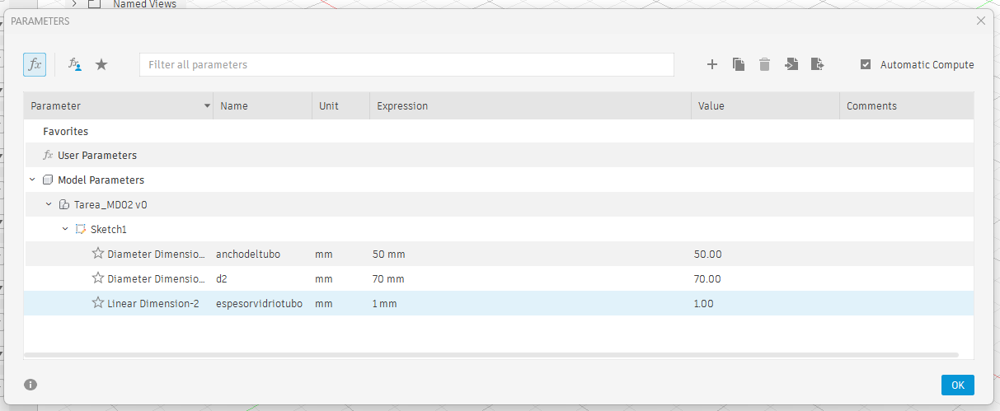
*Configuración de parámetros globales.*

Para facilitar la visualización del ensamble se aplicaron materiales y apariencias acordes (vidrio y polímero):

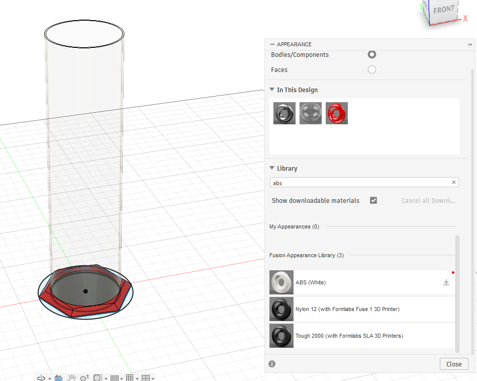
*Modelo tridimensional del tubo con asignación de materiales.*

### Relaciones paramétricas y tolerancias
Un aspecto clave fue definir parámetros calculados mediante fórmulas (suma y factores de otros parámetros), asegurando que cualquier cambio dimensional propague la geometría coherentemente:

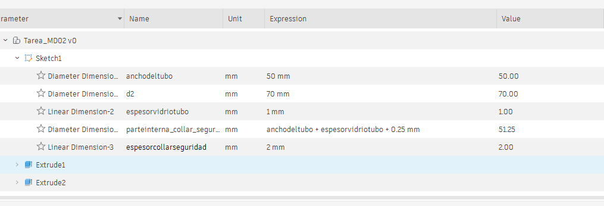
*Fórmulas y dependencias entre variables paramétricas.*

El collar se diseñó abierto para permitir calzarlo lateralmente en el tubo:

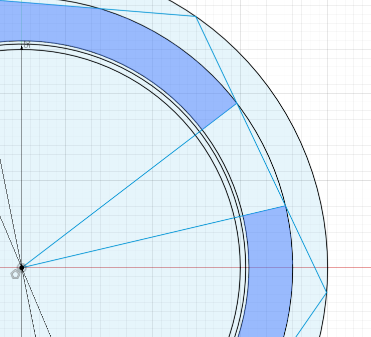
*Diseño del collar con apertura para ensamble.*

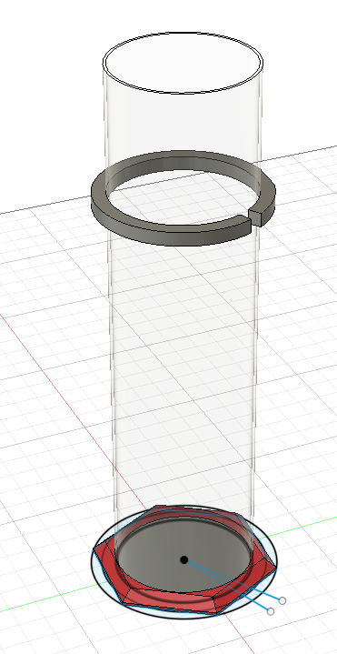
*Extrusión del collar con plano de desfase (offset) para ubicarlo en la zona crítica.*

---

## 3. Ensayo de Inclinación y Protección de Impacto

La intención original era simular el impacto y caída del vidrio mediante el entorno de simulación dinámica de Fusion, función disponible únicamente en la versión comercial. 

Como alternativa, se realizó una simulación geométrica inclinando el conjunto para verificar si el anillo entra en contacto con la superficie antes que el cristal:

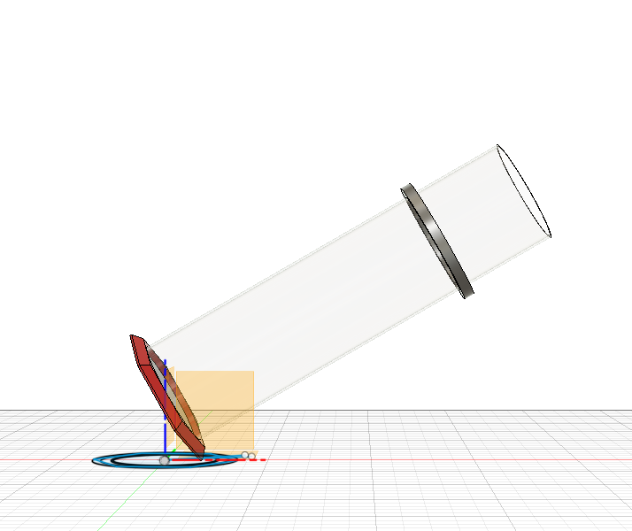
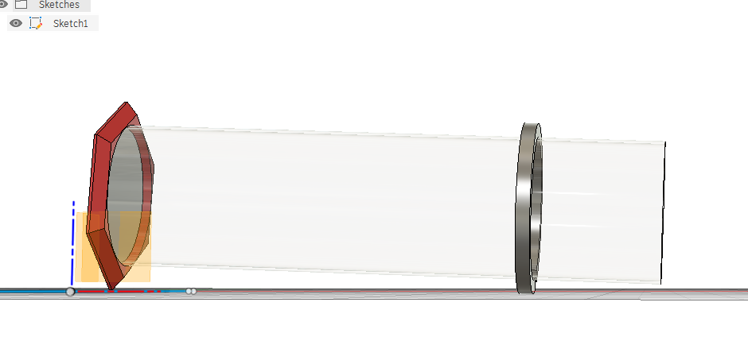
*Comprobación geométrica: el anillo hace contacto con el plano protegiendo el cuerpo de vidrio.*

El ensayo comprobó que el anillo protege efectivamente al tubo, permitiendo incrementar el espesor si se desea mayor margen de seguridad con solo alterar el parámetro correspondiente.

---

## 4. Identidad Visual y Marca: "Lab Bumper"

Para darle identidad al accesorio se definió la marca ficticia **Lab Bumper**. Se utilizaron herramientas de IA (Gemini) para exploración conceptual y de nombres:

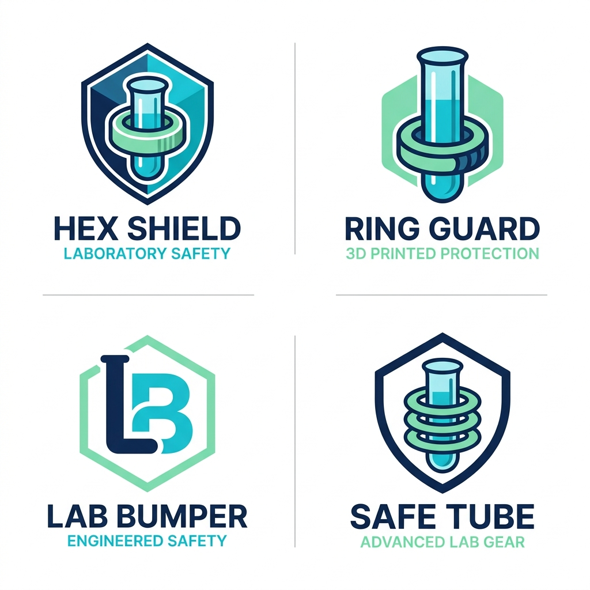
*Exploración de propuestas de logotipos.*

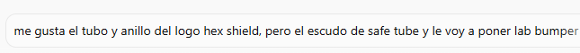
*Prompt para combinar conceptos de escudo y tubo de laboratorio.*

### Vectorización en Inkscape
Para componer el isotipo final se utilizó **Inkscape** (software libre de diseño vectorial):
* Trazado con la herramienta de **Pluma Bézier** (`B`).
* Operaciones de corte y unión de trayectos.
* Organización y jerarquía mediante capas vectoriales.

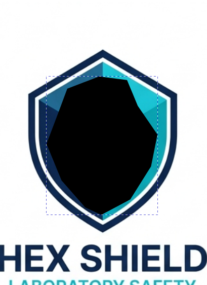
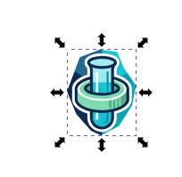
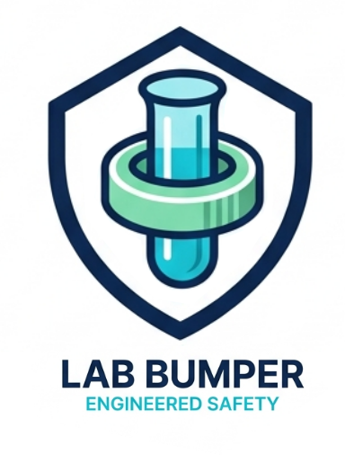
*Proceso de diseño y depuración vectorial del isotipo en Inkscape.*

### Aplicación sobre la pieza (Grabado / Deboss)
El logo vectorial simplificado se exportó a `.svg` y se importó en Fusion para realizar un relieve negativo (*deboss*) sobre el lateral del collar protector:

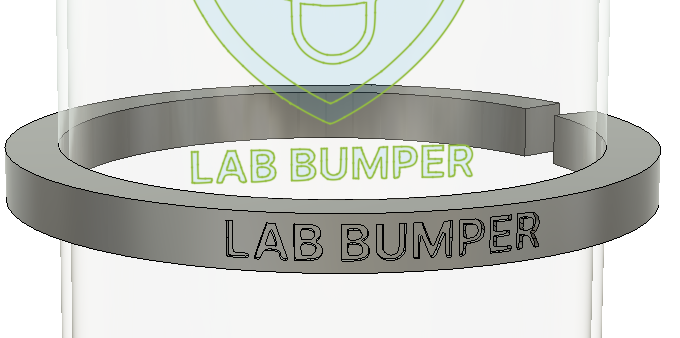
*Grabado bajo relieve del nombre de marca sobre la superficie curva.*

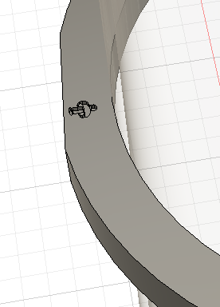
*Detalle del isotipo extruido como textura de agarre.*

---

## 5. Renders y Resultado Final

Utilizando el entorno de renderizado de Fusion 360 se obtuvieron visualizaciones realistas del accesorio montado sobre el tubo de vidrio:

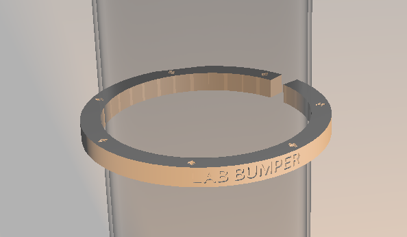
*Renderizado del ensamble Lab Bumper + Tubo de laboratorio.*

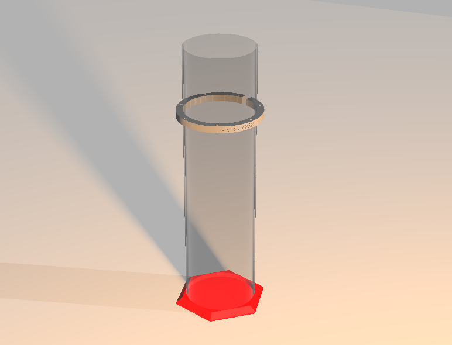
*Vista de perspectiva del producto final.*

---

## 6. Composición de Lámina en GIMP

Para la presentación final del proyecto se utilizó **GIMP** (software libre de manipulación de imágenes pixelar), componiendo una lámina que integra el producto, el despiece, la identidad y una recreación gráfica del contexto de rotura de vidrio en laboratorio:

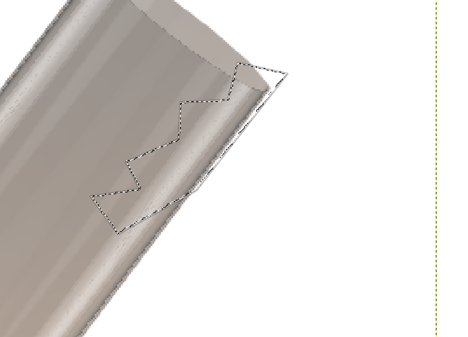
*Trabajo de composición gráfica y efectos en GIMP.*

---

## Archivos de Diseño y Entregables

* 📦 **Modelos 3D:**
  * [Descargar ensamble completo (.3mf)](../files/MT02/labbumper_assembly.3mf)
  * [Descargar Lab Bumper solo (.3mf)](../files/MT02/labbumper_solo.3mf)
  * [Descargar tubo de referencia (.3mf)](../files/MT02/labbumper_tubo_referencia.3mf)
* 🎨 **Vectores e Identidad:**
  * [Descargar Logotipo Completo (.svg)](../files/MT02/logocompleto.svg)
  * [Descargar Logotipo Simplificado (.svg)](../files/MT02/logosimplificado.svg)
* 📄 **Documento de Entrega:**
  * [Descargar Lámina Final de Proyecto (PNG)](../files/MT02/proyecto_tarea2_GIMP.png)
  * [Descargar Documentación Completa en PDF](../files/MT02/PDF_Final_Tarea2.pdf)
