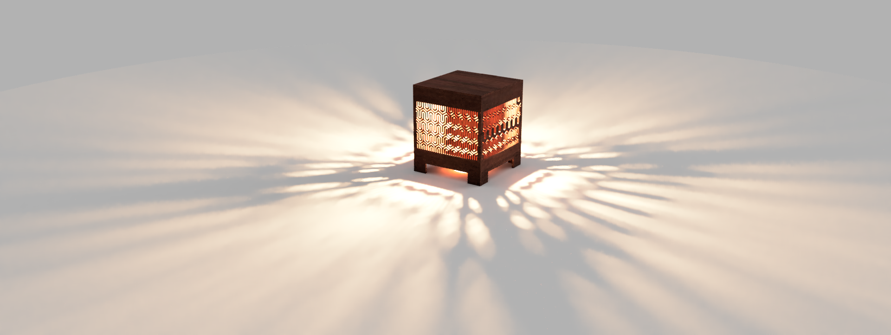
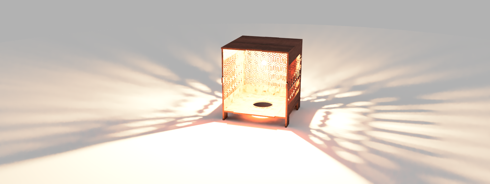
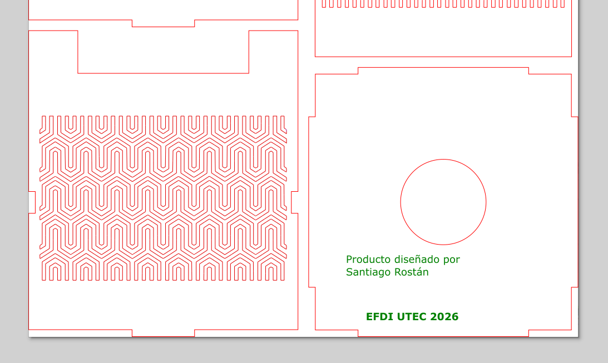
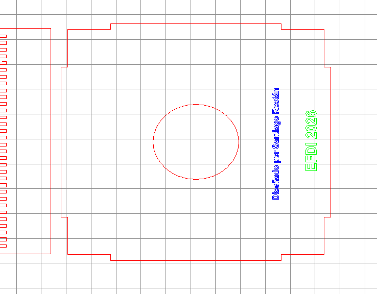
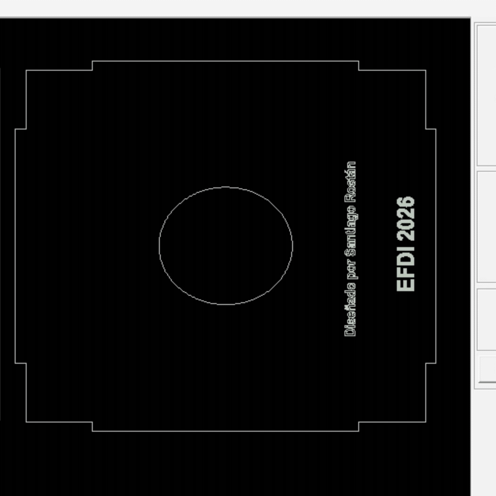

# MT03: Corte Láser - Diseño y Preparación de Lámpara

En esta tarea nos tocó diseñar una lámpara para cortadora láser y posteriormente producirla en el laboratorio de UTEC.

---

## 1. Diseño y Modelado en Fusion 360

Manejo Autodesk Fusion con bastante fluidez, por lo que la etapa inicial de modelado tridimensional fue directa. Sin embargo, al no contar con experiencia previa en diseño específico para corte láser, la generación de componentes y la disposición en plano (*Arrange*) representaron un nuevo aprendizaje.

* **Gestión de licencia:** Mi licencia personal de Fusion no permitía realizar la operación *Arrange* para anidar componentes en la plancha, por lo que debí tramitar la licencia educativa de Autodesk.
* **Patrones y entramado:** El objetivo fue crear una lámpara con un entramado calado atractivo, permitiendo que la luz se disperse generando patrones visuales agradables en el entorno.
* **Rendimiento:** Colorear y codificar cada segmento de los vectores según las convenciones de color asignadas para el corte y grabado resultó de alta exigencia para el hardware del equipo.

  
  

*Vista de la lámpara: izquierda iluminada, derecha abierta mostrando la estructura interior.*

 

*Vista de ensamble de la lámpara cerrada sin iluminación.*

---

## 2. Preparación de Vectores y RDWorks

Para la preparación del corte se organizaron los vectores y se configuraron las capas de grabado y corte en el software RDWorks:

*Disposición de los componentes planos para el corte láser.*

### Configuración del grabado (Raster)
Durante la preparación en **RDWorks** surgió una duda al configurar el raster, ya que en la vista previa del área de trabajo no aparecía rellenado de color verde continuo como en la demostración:

Sin embargo, al correr la herramienta de simulación de mecanizado, la trayectoria de rasterizado se ejecutó correctamente sobre el área designada, confirmando la validez de los parámetros asignados.

---

## 3. Simulación y Estado del Proyecto

*Simulación animada del proceso de corte y grabado láser.*

> **Nota de avance:** El diseño digital y la preparación de archivos quedaron finalizados. La producción física y ensayo de tolerancias finales se realizarán durante la instancia presencial en los talleres de UTEC (**FP01**).
